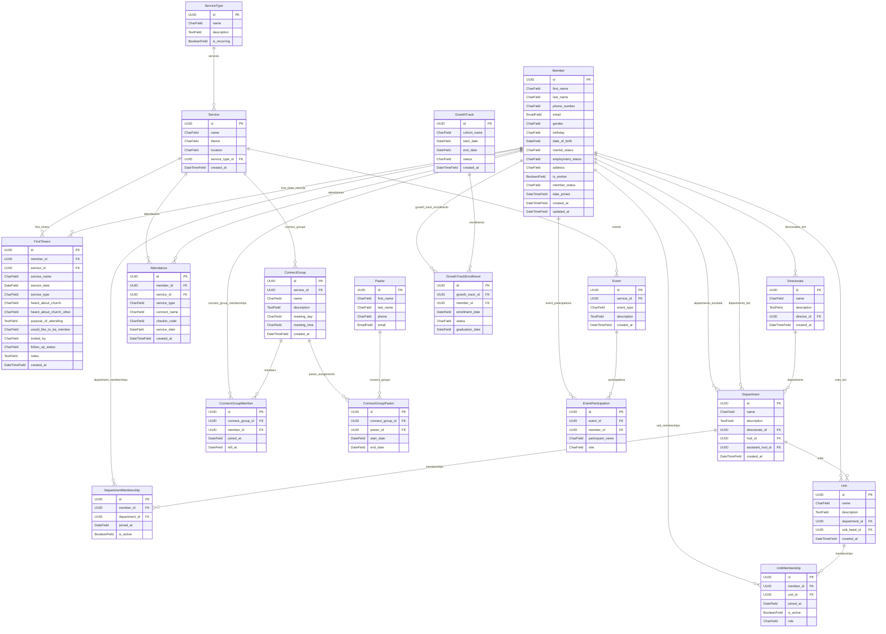

# Django Data Models Summary & Relationships

This document contains the complete normalized data model schema, entity relationship diagrams (ERD), and field specifications for all applications in this project, fully aligned with the database and Prisma schema.

## Entity Relationship Diagram (ERD)

---

## Apps & Models Specification

### App: `apps.members`

#### Model: `Member` (Table: `members`)
| Field Name | Type | Related Model | Attributes / Constraints |
| --- | --- | --- | --- |
| `id` | `UUIDField` | — | PK, default=uuid4, editable=False |
| `first_name` | `CharField` | — | max_length=100 |
| `last_name` | `CharField` | — | max_length=100 |
| `phone_number` | `CharField` | — | max_length=32, unique=True |
| `email` | `EmailField` | — | unique=True, null=True, blank=True |
| `gender` | `CharField` | — | max_length=32, null=True, blank=True |
| `birthday` | `YearlessDateField` | — | null=True, blank=True |
| `date_of_birth` | `DateField` | — | null=True, blank=True |
| `marital_status` | `CharField` | — | max_length=32, null=True, blank=True |
| `employment_status` | `CharField` | — | max_length=32, null=True, blank=True |
| `address` | `CharField` | — | max_length=255, null=True, blank=True |
| `is_worker` | `BooleanField` | — | default=False |
| `member_status` | `CharField` | — | default="regular_member" |
| `date_joined` | `DateTimeField` | — | null=True, blank=True |
| `created_at` | `DateTimeField` | — | auto_now_add=True |
| `updated_at` | `DateTimeField` | — | auto_now=True |

#### Model: `FirstTimers` (Table: `first_timer_events`)
| Field Name | Type | Related Model | Attributes / Constraints |
| --- | --- | --- | --- |
| `id` | `UUIDField` | — | PK, default=uuid4, editable=False |
| `member` | `ForeignKey` | `Member` | on_delete=CASCADE, related_name="first_timer_records" |
| `service` | `ForeignKey` | `Service` | on_delete=SET_NULL, null=True, blank=True |
| `service_name` | `CharField` | — | max_length=200 |
| `service_date` | `DateField` | — |  |
| `service_type` | `CharField` | — | max_length=50, null=True, blank=True |
| `heard_about_church` | `CharField` | — | max_length=50, null=True, blank=True |
| `heard_about_church_other` | `CharField` | — | max_length=200, null=True, blank=True |
| `purpose_of_attending` | `TextField` | — | null=True, blank=True |
| `would_like_to_be_member` | `CharField` | — | max_length=20, null=True, blank=True |
| `invited_by` | `CharField` | — | max_length=150, null=True, blank=True |
| `follow_up_status` | `CharField` | — | default="pending" |
| `notes` | `TextField` | — | null=True, blank=True |
| `created_at` | `DateTimeField` | — | auto_now_add=True |

---

### App: `apps.departments`

#### Model: `Directorate` (Table: `directorate`)
| Field Name | Type | Related Model | Attributes / Constraints |
| --- | --- | --- | --- |
| `id` | `UUIDField` | — | PK, default=uuid4 |
| `name` | `CharField` | — | max_length=150, unique=True |
| `description` | `TextField` | — | blank=True |
| `director` | `ForeignKey` | `Member` | null=True, blank=True, on_delete=SET_NULL |
| `created_at` | `DateTimeField` | — | auto_now_add=True |

#### Model: `Department` (Table: `department`)
| Field Name | Type | Related Model | Attributes / Constraints |
| --- | --- | --- | --- |
| `id` | `UUIDField` | — | PK, default=uuid4 |
| `name` | `CharField` | — | max_length=150, unique=True |
| `description` | `TextField` | — | blank=True |
| `directorate` | `ForeignKey` | `Directorate` | null=True, blank=True, on_delete=CASCADE |
| `hod` | `ForeignKey` | `Member` | null=True, blank=True, on_delete=SET_NULL |
| `assistant_hod` | `ForeignKey` | `Member` | null=True, blank=True, on_delete=SET_NULL |
| `created_at` | `DateTimeField` | — | auto_now_add=True |

#### Model: `DepartmentMembership` (Table: `department_memberships`)
| Field Name | Type | Related Model | Attributes / Constraints |
| --- | --- | --- | --- |
| `id` | `UUIDField` | — | PK, default=uuid4 |
| `member` | `ForeignKey` | `Member` | on_delete=CASCADE |
| `department` | `ForeignKey` | `Department` | on_delete=CASCADE |
| `joined_at` | `DateField` | — |  |
| `is_active` | `BooleanField` | — | default=True |

#### Model: `Unit` (Table: `units`)
| Field Name | Type | Related Model | Attributes / Constraints |
| --- | --- | --- | --- |
| `id` | `UUIDField` | — | PK, default=uuid4 |
| `name` | `CharField` | — | max_length=150 |
| `description` | `TextField` | — | blank=True |
| `department` | `ForeignKey` | `Department` | on_delete=CASCADE |
| `unit_head` | `ForeignKey` | `Member` | null=True, blank=True, on_delete=SET_NULL |
| `created_at` | `DateTimeField` | — | auto_now_add=True |

#### Model: `UnitMembership` (Table: `unit_memberships`)
| Field Name | Type | Related Model | Attributes / Constraints |
| --- | --- | --- | --- |
| `id` | `UUIDField` | — | PK, default=uuid4 |
| `member` | `ForeignKey` | `Member` | on_delete=CASCADE |
| `unit` | `ForeignKey` | `Unit` | on_delete=CASCADE |
| `joined_at` | `DateField` | — |  |
| `is_active` | `BooleanField` | — | default=True |
| `role` | `CharField` | — | max_length=100, blank=True |

---

### App: `apps.services`

#### Model: `ServiceType` (Table: `service_types`)
| Field Name | Type | Related Model | Attributes / Constraints |
| --- | --- | --- | --- |
| `id` | `UUIDField` | — | PK, default=uuid4 |
| `name` | `CharField` | — | max_length=100 |
| `description` | `TextField` | — | blank=True |
| `is_recurring` | `BooleanField` | — | default=False |

#### Model: `Service` (Table: `service`)
| Field Name | Type | Related Model | Attributes / Constraints |
| --- | --- | --- | --- |
| `id` | `UUIDField` | — | PK, default=uuid4 |
| `name` | `CharField` | — | max_length=100 |
| `theme` | `CharField` | — | max_length=255, null=True, blank=True |
| `location` | `CharField` | — | max_length=255, null=True, blank=True |
| `service_type` | `ForeignKey` | `ServiceType` | null=True, blank=True, on_delete=SET_NULL |
| `created_at` | `DateTimeField` | — | auto_now_add=True |

---

### App: `apps.attendance`

#### Model: `Attendance` (Table: `attendance`)
| Field Name | Type | Related Model | Attributes / Constraints |
| --- | --- | --- | --- |
| `id` | `UUIDField` | — | PK, default=uuid4 |
| `member` | `ForeignKey` | `Member` | on_delete=CASCADE |
| `service` | `ForeignKey` | `Service` | on_delete=SET_NULL, null=True, blank=True |
| `service_type` | `CharField` | — | max_length=32 |
| `connect_name` | `CharField` | — | max_length=80, null=True, blank=True |
| `checkin_code` | `CharField` | — | max_length=32, unique=True, null=True, blank=True |
| `service_date` | `DateField` | — |  |
| `created_at` | `DateTimeField` | — | auto_now_add=True |

---

### App: `apps.connect_groups`

#### Model: `ConnectGroup` (Table: `connect_group`)
| Field Name | Type | Related Model | Attributes / Constraints |
| --- | --- | --- | --- |
| `id` | `UUIDField` | — | PK, default=uuid4 |
| `service` | `ForeignKey` | `Service` | on_delete=SET_NULL, null=True, blank=True |
| `name` | `CharField` | — | max_length=150 |
| `description` | `TextField` | — | blank=True |
| `meeting_day` | `CharField` | — | max_length=20 |
| `meeting_time` | `CharField` | — | max_length=80, blank=True |
| `created_at` | `DateTimeField` | — | auto_now_add=True |

#### Model: `ConnectGroupMember` (Table: `connect_group_members`)
| Field Name | Type | Related Model | Attributes / Constraints |
| --- | --- | --- | --- |
| `id` | `UUIDField` | — | PK, default=uuid4 |
| `connect_group` | `ForeignKey` | `ConnectGroup` | on_delete=CASCADE |
| `member` | `ForeignKey` | `Member` | on_delete=CASCADE |
| `joined_at` | `DateField` | — | auto_now_add=True |
| `left_at` | `DateField` | — | null=True, blank=True |

#### Model: `ConnectGroupPastor` (Table: `connect_group_pastors`)
| Field Name | Type | Related Model | Attributes / Constraints |
| --- | --- | --- | --- |
| `id` | `UUIDField` | — | PK, default=uuid4 |
| `connect_group` | `ForeignKey` | `ConnectGroup` | on_delete=CASCADE |
| `pastor` | `ForeignKey` | `Pastor` | on_delete=CASCADE |
| `start_date` | `DateField` | — |  |
| `end_date` | `DateField` | — | null=True, blank=True |

---

### App: `apps.pastors`

#### Model: `Pastor` (Table: `pastors`)
| Field Name | Type | Related Model | Attributes / Constraints |
| --- | --- | --- | --- |
| `id` | `UUIDField` | — | PK, default=uuid4 |
| `first_name` | `CharField` | — | max_length=100 |
| `last_name` | `CharField` | — | max_length=100 |
| `phone` | `CharField` | — | max_length=20 |
| `email` | `EmailField` | — | unique=True |

---

### App: `apps.events`

#### Model: `Event` (Table: `events`)
| Field Name | Type | Related Model | Attributes / Constraints |
| --- | --- | --- | --- |
| `id` | `UUIDField` | — | PK, default=uuid4 |
| `service` | `ForeignKey` | `Service` | on_delete=CASCADE |
| `event_type` | `CharField` | — | max_length=100 |
| `description` | `TextField` | — | blank=True |
| `created_at` | `DateTimeField` | — | auto_now_add=True |

#### Model: `EventParticipation` (Table: `event_participations`)
| Field Name | Type | Related Model | Attributes / Constraints |
| --- | --- | --- | --- |
| `id` | `UUIDField` | — | PK, default=uuid4 |
| `event` | `ForeignKey` | `Event` | on_delete=CASCADE |
| `member` | `ForeignKey` | `Member` | null=True, blank=True, on_delete=SET_NULL |
| `participant_name` | `CharField` | — | max_length=255 |
| `role` | `CharField` | — | max_length=100 |

---

### App: `apps.growth_track`

#### Model: `GrowthTrack` (Table: `growth_tracks`)
| Field Name | Type | Related Model | Attributes / Constraints |
| --- | --- | --- | --- |
| `id` | `UUIDField` | — | PK, default=uuid4 |
| `cohort_name` | `CharField` | — | max_length=100 |
| `start_date` | `DateField` | — |  |
| `end_date` | `DateField` | — |  |
| `status` | `CharField` | — | choices=["planned", "ongoing", "completed"] |
| `created_at` | `DateTimeField` | — | auto_now_add=True |

#### Model: `GrowthTrackEnrollment` (Table: `growth_track_enrollments`)
| Field Name | Type | Related Model | Attributes / Constraints |
| --- | --- | --- | --- |
| `id` | `UUIDField` | — | PK, default=uuid4 |
| `growth_track` | `ForeignKey` | `GrowthTrack` | on_delete=CASCADE |
| `member` | `ForeignKey` | `Member` | on_delete=CASCADE |
| `enrollment_date` | `DateField` | — |  |
| `status` | `CharField` | — | choices=["active", "completed", "dropped"] |
| `graduation_date` | `DateField` | — | null=True, blank=True |
